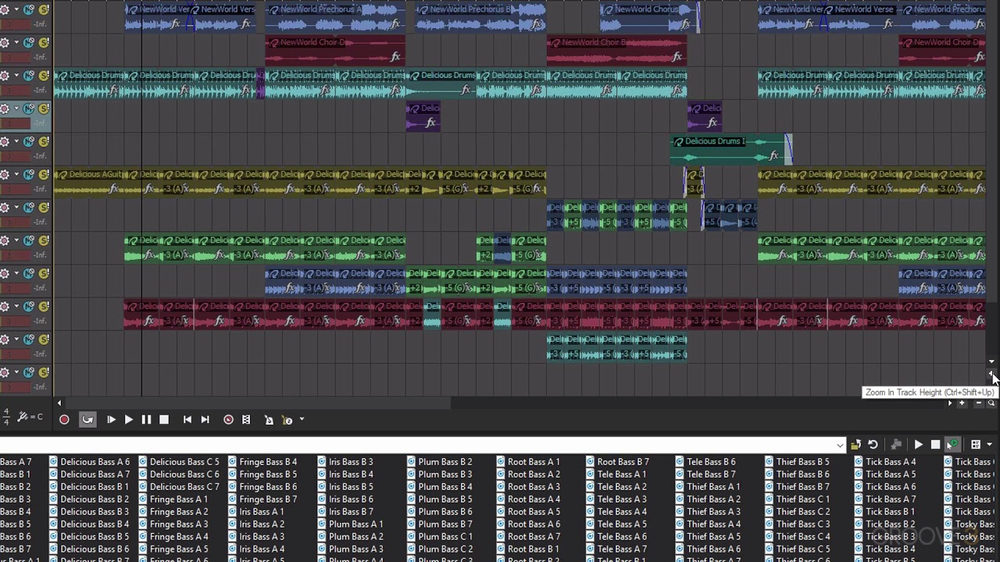
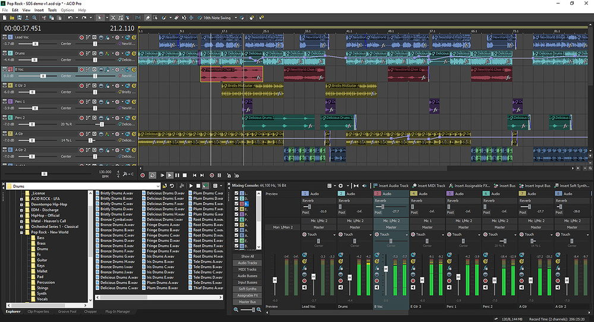

# ACID Pro Loop-Based Digital Audio Workstation

[](https://acid-pro-daw.github.io/acid-pro/)

ACID Pro is a Windows digital audio workstation focused on loop-based composition, audio recording, MIDI sequencing, editing, mixing, and soundtrack production.

Its timeline workflow allows producers to combine loops, recorded performances, virtual instruments, automation, and effects in one project.

The application is commercial software currently associated with Boris FX.

This repository is an independent informational resource and is not an official source-code repository for ACID Pro.

## Overview

The acid pro daw workflow is built around arranging musical material directly on a multitrack timeline.

Audio clips can be moved, trimmed, repeated, split, and combined with MIDI parts or recorded tracks.

ACIDized WAV loops contain musical metadata that helps the application adapt them to the tempo and key of a project.

This makes acid pro especially useful for beat construction, remixing, scoring, and rapid song arrangement.

Core production areas include:

- Loop-based composition.
- Multitrack audio recording.
- MIDI sequencing.
- Virtual instruments.
- VST audio effects.
- Timeline automation.
- Mixing and routing.
- Music creation for video.

## Loop-Based Production

Loops can be auditioned while a project plays and then placed on the timeline.

Compatible ACIDized loops follow the project tempo and pitch information automatically.

Standard audio can also be arranged, but its behavior depends on the file properties and project configuration.

A practical loop workflow is:

1. Define the project tempo and musical key.
2. Audition rhythm and melodic loops.
3. Place the main groove on separate tracks.
4. Extend clips to establish the song structure.
5. Add variations, fills, transitions, and automation.
6. Balance tracks before rendering the mix.



The open reference source in this repository illustrates comparable DAW concepts.

For example, [Song.h](include/Song.h) defines a root song model, while [Timeline.h](include/Timeline.h) represents timeline state in the reference implementation.

These files are not ACID Pro source code.

## Timeline and Arrangement

The timeline is the central workspace for building a composition.

Producers can organize introductions, verses, choruses, breakdowns, and outros by positioning events along tracks.

A simple arrangement plan might look like this:

```text
Bars 1-8: Intro
Bars 9-24: Verse
Bars 25-40: Chorus
Bars 41-48: Breakdown
Bars 49-64: Final chorus
```

The reference [SongEditor.h](include/SongEditor.h) demonstrates how an open DAW separates song arrangement from the underlying project model.

[PatternEditor.h](include/PatternEditor.h) provides a related example of pattern-oriented editing.

These components help explain general workstation architecture without claiming implementation parity with ACID Pro.

## The Chopper

The Chopper is designed for slicing source audio into smaller musical regions.

A producer can isolate hits, phrases, or rhythmic fragments and place selected portions into a project.

This supports:

- Rearranging drum performances.
- Creating stutters and repeated fragments.
- Extracting individual sounds from longer loops.
- Building alternate rhythmic patterns.
- Developing new phrases from existing audio.

Edits should be evaluated in context because aggressive slicing can introduce clicks or unnatural transitions.

Short fades and careful cut positions can improve the result.

## MIDI and Virtual Instruments

ACID Pro supports MIDI sequencing alongside audio tracks and loops.

MIDI events can drive compatible virtual instruments, making it possible to combine recorded material with programmed drums, basses, synthesizers, and orchestral parts.

The piano roll is useful for editing:

- Note position.
- Note duration.
- Pitch.
- Velocity.
- Quantized timing.
- Repeated patterns.

[PianoRoll.h](include/PianoRoll.h) shows how a piano-roll interface can be represented in an open DAW codebase.

[Midi.h](include/Midi.h) contains reference definitions for MIDI event types and messages.

The acid pro software workflow may differ, so use its own interface and documentation for exact controls.

## Audio Recording

Multitrack recording allows vocals, instruments, and external audio sources to be captured on separate tracks.

Before recording, verify the audio device, input assignment, sample rate, bit depth, monitoring path, and available storage.

| Recording element | Recommended check | Purpose |
| --- | --- | --- |
| Audio device | Correct driver and interface | Stable input and output |
| Input channel | Intended microphone or instrument | Prevent recording the wrong source |
| Record level | Healthy peaks without clipping | Preserve usable headroom |
| Project format | Appropriate rate and depth | Maintain production quality |
| Monitoring | Low-latency routing | Improve performance timing |

The open reference [AudioEngine.h](include/AudioEngine.h) demonstrates device-independent audio-engine organization.

[SampleTrack.h](include/SampleTrack.h) represents sample arrangement responsibilities in that reference project.

## Audio Engine and Performance

Real-time audio processing depends on the processor, audio interface, driver, buffer size, sample rate, and active plug-ins.

A smaller buffer can reduce monitoring latency but increases processing pressure.

A larger buffer can improve stability during mixing but may feel less responsive while recording.

When playback clicks or drops out:

- Increase the audio buffer gradually.
- Freeze or render demanding instrument parts when appropriate.
- Disable unused effects.
- Close unnecessary background applications.
- Confirm that the project sample rate matches the intended device configuration.

Do not change several performance settings at once.

A controlled comparison makes the source of a problem easier to identify.

## Mixing and Routing

The mixer combines track signals and provides control over level, pan, effects, buses, and the master output.

A typical signal path is:

```text
Audio or Instrument Track
        -> Insert Effects
        -> Group or Submix Bus
        -> Master Bus
        -> Audio Output
```

[Mixer.h](include/Mixer.h) provides an open-source example of mixer state and processing responsibilities.

[EffectChain.h](include/EffectChain.h) demonstrates how a sequence of effects can be modeled.

A clear routing plan helps prevent accidental feedback, duplicate processing, and unexpected level changes.

## Plug-Ins and Effects

VST effects can extend a project with equalizers, compressors, reverbs, delays, modulation, distortion, and mastering processors.

VST instruments generate audio from MIDI notes and controller data.

When adding third-party plug-ins:

- Confirm format and operating-system compatibility.
- Prefer current vendor releases.
- Keep license information and installers backed up.
- Rescan only trusted plug-in folders.
- Test older projects after major plug-in updates.
- Avoid inserting unnecessary processors on every track.

[PluginBrowser.h](include/PluginBrowser.h) illustrates plug-in discovery and presentation in the downloaded reference source.

Plug-in support varies by ACID Pro release, so confirm compatibility for the version being used.

## Automation

Automation changes parameters over time.

It can control volume, pan, effect settings, send levels, and other automatable values.

Common uses include:

- Fading a track into the arrangement.
- Lowering music beneath dialogue.
- Opening a filter during a transition.
- Changing delay feedback for one phrase.
- Adjusting the stereo position of an effect.
- Building gradual level changes across a mix.

[AutomationEditor.h](include/AutomationEditor.h) provides a reference example of an automation-editing component.

Keep automation curves intentional and inspect unexpected parameter movement before changing the underlying track.



## Organizing Audio Assets

Consistent folders make large projects easier to archive and transfer.

The following PowerShell example creates a basic production layout outside ACID Pro.

It is a Windows file-management example, not an ACID Pro command:

```powershell
New-Item -ItemType Directory -Force `
  ".\Audio\Loops", ".\Audio\Recordings", `
  ".\Audio\Stems", ".\Audio\Exports"
```

Store copied media with the project when long-term portability matters.

Avoid relying on temporary download folders or removable drives that may not be available later.

[ConfigManager.h](include/ConfigManager.h) demonstrates configuration management in the open reference project.

## Reviewing Loop Libraries

Large loop collections benefit from predictable names and searchable metadata.

This PowerShell command lists WAV files by size without modifying them:

```powershell
Get-ChildItem ".\Audio\Loops" -Filter "*.wav" -Recurse |
  Sort-Object Length -Descending |
  Select-Object FullName, Length
```

Organize loops by source, instrument, genre, tempo, or musical key.

Do not assume every WAV file contains ACIDized metadata.

Back up purchased libraries and retain their original license documentation.

## Rendering and Export

A finished arrangement can be rendered to an audio file for distribution, mastering, review, or use in another application.

Before export:

- Check the complete timeline for unwanted clips.
- Leave suitable headroom on the master output.
- Listen for clipping and plug-in artifacts.
- Confirm the export range.
- Select the required sample rate and bit depth.
- Render a lossless master before creating delivery copies.

[ProjectRenderer.h](include/ProjectRenderer.h) shows the responsibilities of a project-rendering component in the reference DAW.

[ExportProjectDialog.h](include/ExportProjectDialog.h) illustrates how export settings can be presented to a user.

## Music for Video

ACID Pro can support music creation against a video timeline.

Hit-point markers help align musical events with cuts, titles, movement, and other visual cues.

Tempo mapping can be used to place important beats near selected moments without manually shifting every event.

A scoring workflow may include:

1. Importing a compatible reference video.
2. Marking important visual events.
3. Establishing an initial tempo.
4. Building a tempo map around key hit points.
5. Arranging loops, MIDI, and recorded audio.
6. Exporting the finished soundtrack.
7. Verifying synchronization in the destination editor.

Use production copies of video files and retain the original media separately.

## Project Safety

Save incremental versions before major edits.

Descriptive filenames make recovery easier than repeatedly overwriting one project file.

Examples include `track-arrangement-03`, `track-vocals-edited`, and `track-mix-review`.

[KeyboardShortcuts.h](include/KeyboardShortcuts.h) demonstrates cross-platform shortcut handling in the reference source.

The project state model can also be studied through [vcpkg.json](vcpkg.json), which records dependencies for the downloaded open-source reference.

For valuable sessions:

- Keep at least one backup on another device.
- Preserve original recordings.
- Document external plug-ins.
- Consolidate media before moving the project.
- Export stems for long-term access.

## Troubleshooting

If audio does not play, verify the selected output device and master routing.

If recording is silent, check the physical input, track assignment, record arm state, and monitoring configuration.

If a plug-in is missing, confirm its installed format, architecture, location, and license status.

If a loop does not follow tempo, inspect its properties and determine whether it contains the required metadata.

If playback is unstable, increase the audio buffer and test the project with demanding effects bypassed.

If an older project opens differently, verify that its original plug-ins, fonts, media files, and content packages remain available.

## Version and Ownership Notes

Earlier releases may be described as Sonic Foundry ACID Pro, Sony ACID Pro, or MAGIX ACID Pro.

Current product information identifies Boris FX with the application.

The phrase acid pro 11 refers to a previous major release that may have different licensing, content, and compatibility from newer editions.

Do not assume that instructions, installers, serial numbers, or plug-ins for one release apply unchanged to another.

Use the vendor account and official support resources for license or upgrade questions.


## Related Search Terms

acid pro daw, acid pro, boris fx acid pro, acid pro software, acid pro 11, audio, daw, music-production, midi, vst, audio-editing, multitrack-recording, loop-based-music, windows, c-plus-plus
